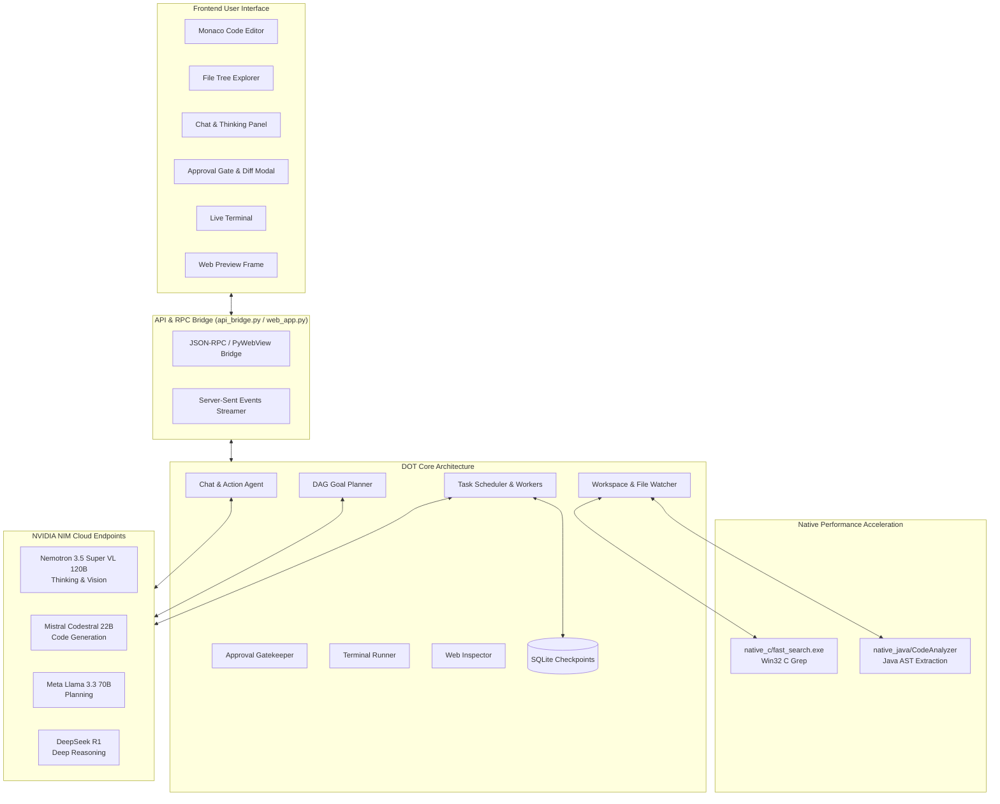

# DOT AI — Autonomous Code Editor & Software Architect [NVIDIA NIM Powered]

[](https://build.nvidia.com)
[](https://python.org)
[-007ACC?style=for-the-badge&logo=visualstudiocode&logoColor=white)](https://microsoft.github.io/monaco-editor/)
[](native_c/)
[](Dockerfile)
[](LICENSE)

**DOT AI** is a local-first, folder-centric autonomous AI code editor and software development environment. Powered by **NVIDIA NIM** models—featuring **NVIDIA Nemotron 3.5 Super VL 120B with Thinking process streaming**, **Mistral Codestral 22B**, **Llama 3.3 70B**, and **DeepSeek R1**—DOT AI unifies conversational pair programming, autonomous multi-task execution, native system performance, and strict human-in-the-loop safety.

---

## 📑 Table of Contents

- [Key Architecture & Capabilities](#-key-architecture--capabilities)
- [System Architecture](#-system-architecture)
- [Project Directory Structure](#-project-directory-structure)
- [NVIDIA NIM AI Workforce](#-nvidia-nim-ai-workforce)
- [Getting Started](#-getting-started)
  - [Prerequisites](#prerequisites)
  - [Option 1: Windows Desktop Application](#option-1-windows-desktop-application)
  - [Option 2: Browser & Web Mode](#option-2-browser--web-mode)
  - [Option 3: Docker & Containerized Mode](#option-3-docker--containerized-mode)
- [Configuration & API Setup](#-configuration--api-setup)
- [Workflows & Core Modules](#-workflows--core-modules)
  - [Conversational Pair-Programming](#1-conversational-pair-programming)
  - [Autonomous Multi-Goal DAG Planner](#2-autonomous-multi-goal-dag-planner)
  - [Human-in-the-Loop Diff Gatekeeper](#3-human-in-the-loop-diff-gatekeeper)
  - [Native C Search Accelerator](#4-native-c-search-accelerator)
  - [Java Code Intelligence Engine](#5-java-code-intelligence-engine)
  - [Live Terminal Runner & Web Inspector](#6-live-terminal-runner--web-inspector)
- [Environment Variables Reference](#-environment-variables-reference)
- [License](#-license)

---

## 🌟 Key Architecture & Capabilities

### 1. Monaco Code Editor Core
- Built on Microsoft's **Monaco Editor** (the engine driving VS Code).
- High-fidelity syntax highlighting for Python, C/C++, Java, JavaScript, TypeScript, HTML/CSS, JSON, Markdown, and SQL.
- Multi-tab document management, code folding, minimap navigation, indentation guides, and hotkeys (`Ctrl+S` auto-save).

### 2. Conversational Chat Agent with Thinking Visualization
- Dual-channel chat interface separating conversational explanation from code generation.
- **Thinking Process Streaming**: Displays real-time internal reasoning chains from reasoning models like Nemotron Super VL and DeepSeek R1 before final actions.
- **Strict Code-Dumping Prevention**: Eliminates unwieldy, unformatted code dumps in chat. Modifications are packaged into discrete action cards.

### 3. Human-in-the-Loop Safety Gatekeeper
- **Zero Unauthorized Modifications**: AI agents cannot modify files or execute shell commands autonomously without user sign-off.
- **Interactive Visual Diff Review**: Proposed file changes are presented in a unified side-by-side diff modal showing additions, removals, and unchanged context.
- 1-Click Approve / Reject mechanism with immediate rollback capability.

### 4. Autonomous DAG Task Planner
- **Multi-Goal Intake Engine**: Break complex software development objectives into a Directed Acyclic Graph (DAG) of actionable subtasks.
- Automatic dependency resolution, step-by-step progress tracking, task verification, and checkpoint persistence via SQLite (`dot_workspace.db`).

### 5. Native Performance Engines (C & Java)
- **High-Speed C Grep (`native_c/fast_search.exe`)**: A compiled Win32 C search engine that scans recursive file trees and matches patterns across thousands of files in milliseconds, eliminating Python interpreter overhead.
- **Java AST Analyzer (`native_java/dot/java/CodeAnalyzer.java`)**: Custom parser extracting package declarations, imports, class hierarchies, and method signatures into structured JSON for LLM context.

### 6. Interactive Terminal & Web Crawler
- **PowerShell / Bash Terminal Runner**: Live asynchronous execution of compiler runs (`gcc`, `javac`, `mvn`, `npm`, `pytest`) with real-time stdout/stderr streaming.
- **Web Inspector**: Built-in scraper using `aiohttp`, `BeautifulSoup4`, and `trafilatura` to crawl external documentation or preview local web applications running on the built-in development server.

---

## 🏗️ System Architecture



---

## 📂 Project Directory Structure

```plaintext
NVIDIA_DOT/
├── .env.example              # Template for NVIDIA API keys and configuration
├── .gitignore                # Excludes secrets, databases, and build artifacts
├── Dockerfile                # Multi-stage production container build
├── docker-compose.yml        # Docker compose service definition
├── DOCKER_GUIDE.md           # Guide for containerized deployment & cloud hosting
├── LICENSE                   # MIT Open Source License
├── README.md                 # Project documentation & architecture overview
├── requirements.txt          # Python package dependencies
├── run_editor.bat            # One-click Windows launch script
├── config.py                 # System configuration, paths, and model defaults
├── api_bridge.py             # Desktop API RPC bridge between UI and Python core
├── desktop_app.py            # PyWebView native Windows desktop entry point
├── web_app.py                # Standalone aiohttp web server for browser & Docker
│
├── core/                     # Autonomous engine core modules
│   ├── approval_gate.py      # Human-in-the-loop action verification and approval
│   ├── chat_agent.py         # Conversational agent with thinking & action parser
│   ├── checkpoint.py         # SQLite workspace persistence and recovery
│   ├── nvidia_client.py      # NVIDIA NIM OpenAI-compatible async streaming client
│   ├── planner.py            # DAG task decomposition and dependency planner
│   ├── scheduler.py          # Multi-goal queue and concurrent task scheduler
│   ├── terminal_runner.py    # Shell and PowerShell process execution runner
│   ├── web_inspector.py      # Web scraper, DOM reader, and local preview server
│   └── workspace.py          # File system manager, diff calculator, native bridge
│
├── native_c/                 # C-native high-performance search engine
│   ├── fast_search.c         # Win32 recursive file search & grep implementation
│   ├── fast_search.exe       # Compiled binary executable
│   └── fast_search.dll       # Shared library
│
├── native_java/              # Java AST analysis engine
│   └── dot/java/
│       ├── CodeAnalyzer.java # Java source code analyzer and method extractor
│       └── CodeAnalyzer.class# Compiled bytecode
│
└── ui/                       # Frontend assets
    ├── index.html            # Main IDE layout and Monaco container
    ├── css/
    │   └── style.css         # Dark theme UI styling (VS Code / NVIDIA inspired)
    └── js/
        ├── app.js            # Workspace initialization and IPC handler
        ├── browser.js        # Web crawler and preview browser controller
        ├── chat.js           # Streaming chat, markdown parser, and thinking renderer
        ├── dot_panel.js      # Goal planner and task graph dashboard
        ├── editor.js         # Monaco editor initialization, tabs, and diff engine
        └── web_bridge.js     # Fallback RPC bridge for browser/SSE mode
```

---

## 🤖 NVIDIA NIM AI Workforce

DOT AI orchestrates specialized foundation models hosted on **NVIDIA NIM** to deliver state-of-the-art software intelligence:

| Role | Model Identifier | Purpose |
| :--- | :--- | :--- |
| **Primary Architect & Vision** | `nvidia/nemotron-3.5-super-vl-120b-a12b` | Conversational guidance, multimodal code reasoning, thinking token streams, and architecture. |
| **Code Specialist** | `mistralai/codestral-22b-v0.1` | Precise syntax completion, refactoring, unit test generation, and bug fixing. |
| **Strategic Planner** | `meta/llama-3.3-70b-instruct` | Breaking broad development prompts into dependency-ordered DAG subtasks. |
| **Deep Reasoner** | `deepseek-ai/deepseek-r1` | Complex algorithmic problem-solving, mathematical proofs, and logic audits. |

---

## 🚀 Getting Started

### Prerequisites

- **Python 3.10+** (Python 3.11 or 3.12 recommended)
- **NVIDIA NIM API Key**: Free trial keys available at [build.nvidia.com](https://build.nvidia.com).
- *(Optional)* **GCC / MinGW**: For modifying and recompiling `native_c/fast_search.c`.
- *(Optional)* **JDK 21**: For analyzing Java codebases via `native_java/`.

---

### Option 1: Windows Desktop Application

For the native desktop experience with native folder picker dialogs:

1. **Clone the repository**:
   ```bash
   git clone https://github.com/ohmcs-design/nvidiadot.git
   cd nvidiadot
   ```

2. **Create and activate a virtual environment**:
   ```bash
   python -m venv .venv
   .venv\Scripts\activate
   ```

3. **Install dependencies**:
   ```bash
   pip install -r requirements.txt
   ```

4. **Configure your API Key**:
   Copy `.env.example` to `.env` and add your key:
   ```bash
   copy .env.example .env
   ```
   *(Or enter it directly inside the IDE Settings modal)*.

5. **Launch the application**:
   ```bash
   python desktop_app.py
   ```
   *Alternatively, double-click `run_editor.bat`.*

---

### Option 2: Browser & Web Mode

Run DOT AI as a local web service without desktop window dependencies:

1. **Start the web server**:
   ```bash
   python web_app.py --port 8080 --workspace .
   ```

2. **Open in browser**:
   Navigate to **`http://localhost:8080`**.

---

### Option 3: Docker & Containerized Mode

Deploy instantly across Windows, macOS, or Linux using Docker:

1. **Start via Docker Compose**:
   ```bash
   docker-compose up --build
   ```

2. **Access the IDE**:
   Open **`http://localhost:8080`** in your browser. Any project files mapped to the container volume will be edited in real time.

For full container details, see [DOCKER_GUIDE.md](DOCKER_GUIDE.md).

---

## ⚙️ Configuration & API Setup

1. Launch DOT AI.
2. In the top navigation bar, click the **NVIDIA API** button.
3. Enter your NVIDIA API key (`nvapi-...`).
4. Click **Test Connection** to verify connectivity with NVIDIA NIM microservices.
5. Click **Save Settings**. Your configuration is saved locally in `.env`.

---

## 🛠️ Workflows & Core Modules

### 1. Conversational Pair-Programming
- Select any active file in Monaco editor and enter instructions in the Chat sidebar.
- DOT AI streams its internal reasoning (**Thinking mode**) followed by a concise conversational explanation.
- Code changes are automatically rendered in a discrete **Approve Action Card**.

### 2. Autonomous Multi-Goal DAG Planner
- Click the **DOT AI Workforce** tab.
- Enter a high-level goal (e.g., *"Refactor database layer to support connection pooling and write pytest tests"*).
- The Planner invokes `meta/llama-3.3-70b-instruct` to formulate a multi-stage dependency graph.
- Review and approve the plan to watch the autonomous worker execute each step sequentially.

### 3. Human-in-the-Loop Diff Gatekeeper
- Whenever the AI attempts to write or update a file, an approval request is triggered.
- Click **Review Diff** to inspect a side-by-side comparison of original vs. proposed lines.
- Click **Approve** to commit the changes to disk, or **Reject** to abort.

### 4. Native C Search Accelerator
- Search across massive codebases using the native C engine.
- Bypasses Python traversal overhead using Win32 API file enumerations.
- Recompile anytime using MinGW:
  ```bash
  gcc -O3 native_c/fast_search.c -o native_c/fast_search.exe
  ```

### 5. Java Code Intelligence Engine
- Integrated Java AST analyzer parses `.java` files across your project.
- Emits structured JSON outlining packages, imports, class hierarchies, and method signatures.
- Recompile anytime with JDK:
  ```bash
  javac native_java/dot/java/CodeAnalyzer.java
  ```

### 6. Live Terminal Runner & Web Inspector
- Run compiler commands, linters, or test suites directly from the bottom terminal pane.
- Web projects can be previewed live via the integrated lightweight HTTP server.
- Web Inspector allows crawling external URLs to provide documentation context directly to the LLM.

---

## 📋 Environment Variables Reference

| Variable | Default Value | Description |
| :--- | :--- | :--- |
| `NVIDIA_API_KEY` | `""` | NVIDIA NIM API access token (`nvapi-...`) |
| `NVIDIA_BASE_URL` | `https://integrate.api.nvidia.com/v1` | NIM OpenAI-compatible endpoint URL |
| `TARGET_NEMOTRON_MODEL` | `nvidia/nemotron-3.5-super-vl-120b-a12b` | Primary multimodal & thinking model |
| `DEFAULT_PLANNER_MODEL` | `meta/llama-3.3-70b-instruct` | Default model for DAG plan generation |
| `DEFAULT_CODER_MODEL` | `nvidia/nemotron-3.5-super-vl-120b-a12b` | Default model for code synthesis |
| `MODEL_TEMPERATURE` | `1.0` | Sampling temperature |
| `MODEL_TOP_P` | `0.95` | Top-p nucleus sampling |
| `MODEL_MAX_TOKENS` | `16384` | Max generation tokens |
| `ENABLE_THINKING` | `true` | Enables thinking token streaming for reasoning models |
| `MAX_CONCURRENT_GOALS` | `5` | Maximum simultaneous autonomous tasks |
| `AUTO_APPROVE_READONLY` | `true` | Auto-permits non-destructive read operations |

---

## 📄 License

This project is open-source and distributed under the [MIT License](LICENSE).
Feel free to use, modify, and distribute it in personal or commercial projects.
